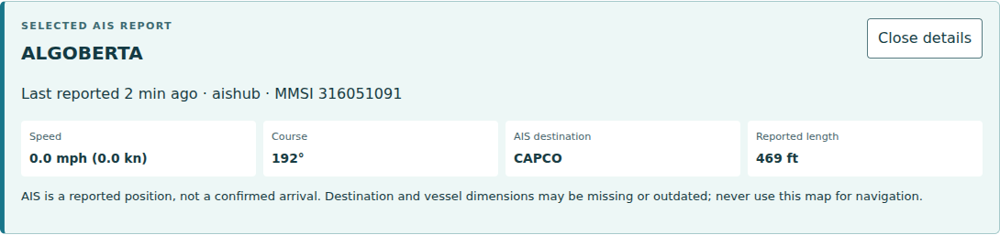
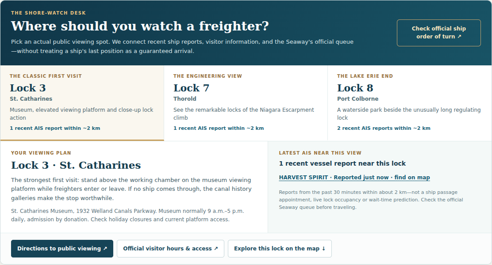
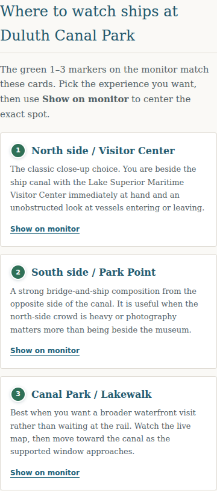

# Shipping demonstrations and outreach drafts

Prepared November 9, 2026. **Nothing sent or published.** These drafts promote existing production tools; the new internal handoffs require their own merge/deployment. Dates and ship positions below describe the capture, not a continuing promise.

## Three ready-to-edit demonstrations

### 1. Find a ship, then check the report

**Caption:** “Wondering where a Great Lakes freighter is? I built a free map where you can search a ship's name, open its latest available AIS report and check when that position was reported. Start there, then use the local ship-watching tools for the Soo, Duluth or Welland. Coverage can be incomplete, and a reported destination isn't an arrival time. Built by Chris Izworski.”

**Link:** https://chrisizworski.com/great-lakes-freighter-tracking/?utm_source=owned_social&utm_medium=social&utm_campaign=shipping_nov2026&utm_content=find_ship

**Demonstration:** Open the tracker, type a name actually present in the current feed, open its report and point out the age, speed and reported destination. Clear the search to return to all vessels. If a ship isn't reporting, show that honestly rather than implying it is gone.

**Captured evidence:** At 15:50 UTC on November 9 the production page showed 157 recent reports. ALGOBERTA's selected report showed an age of two minutes, zero reported speed and destination CAPCO. That is a demonstration of the report card, not independently confirmed ship movement.

### 2. Choose a Welland viewing spot

**Caption:** “At the Welland Canal, knowing a ship's location is only part of the visit. My tool lets you compare Lock 3, Lock 7 and Port Colborne, see recent nearby vessel reports, get directions to public viewing and check the Seaway's official order of turn. Pick the place first, then check the traffic and visitor access before heading over. Built by Chris Izworski.”

**Link:** https://chrisizworski.com/welland-canal/?utm_source=owned_social&utm_medium=social&utm_campaign=shipping_nov2026&utm_content=choose_lock

**Demonstration:** Show the Lock 3 viewing card, switch to Lock 7 and Lock 8, then show the directions and official visitor-information links. Open the official order of turn separately. Nearby AIS is not a promised passage or a live occupancy count.

**Captured evidence:** Production Lock 3 showed one recent nearby report, HARVEST SPIRIT, at the capture. The public-viewing description, directions and official-source links are visible in the screenshot.

### 3. Check Duluth's traffic and choose a camera

**Caption:** “Already at Canal Park, or watching from home? My Duluth monitor puts recent ship reports, supported near-term passage estimates, camera choices and three public viewing spots together. When it cannot support a passage time, it says so. You can still choose a camera or find a place to watch. Built by Chris Izworski.”

**Link:** https://chrisizworski.com/duluth-canal-park/?utm_source=owned_social&utm_medium=social&utm_campaign=shipping_nov2026&utm_content=canal_camera

**Demonstration:** Show the next-watch status, select a camera, and open the viewing-spots section. Keep the camera operator attribution and direct-provider link visible. Load video only on request. Do not say “a ship is arriving now” without current supporting evidence.

**Captured evidence:** Production showed 11 nearby AIS reports but zero supported passage candidates, plus 19 camera feeds across 15 sites and three viewing spots. Camera selection was checked separately on a 390px viewport. The capture does not establish successful live-video playback. The full monitor screenshot has unrendered map background tiles in this capture environment, so use the viewing close-up below for the draft; do not publish the full monitor screenshot as a finished map demonstration.

These are screenshots of the actual production interface, not generated artwork or simulated vessel results. Keep visible data/provider attribution. Refresh dated ship evidence before publication. Internal navigation uses clean URLs; campaign parameters belong only on external promotion links. Replace `owned_social` with the actual publication/channel name for authorized distribution, without personal identifiers.

## Researched recipients and matched drafts

### Lake Superior Magazine: Duluth resource demonstration

**Why it fits:** Their [boat-traffic resource page](https://www.lakesuperior.com/boats.html) already brings together ship trackers and harbor cameras. Our specific proposition is the transition from a supported passage or an unknown ETA to camera and public viewing choices. This is a complementary resource suggestion, not a claim to replace Harbor Lookout, BoatNerd or camera operators.

**Verified route:** [Editorial contact page](https://www.lakesuperior.com/aboutus/contactus/contact-us.html), `edit@lakesuperior.com`. Their [article submission guidelines](https://www.lakesuperior.com/aboutus/submission-guidelines/editorial-guidelines/) describe a potentially months-long editorial response, so this is not a dependable two-week traffic source. A web-resource suggestion has no stated response promise.

**Subject:** Duluth ship-watching tool for your boat-traffic resources

“Hello,

I'm Chris Izworski, a Michigan-based builder of Great Lakes tools. I noticed your boat-traffic page connects readers to schedules, trackers and harbor cameras.

I built a Duluth monitor that helps someone take the next step: check current ship reports, see whether a near-term passage is supported, choose a camera and find a public viewing spot. It keeps source links and tells visitors when an arrival time isn't supported.

Here is the tool: https://chrisizworski.com/duluth-canal-park/

I've attached a short screenshot demonstration. If you find it useful for your readers, would you consider it as an additional resource on the boat-traffic page? I'd also welcome feedback on what would make it more useful.

Chris Izworski”

### BoatNerd: transparent tool-feedback request

**Why it fits:** A dedicated Great Lakes shipping community, with its own established AIS and passage services. Use a respectful feedback request about the viewing handoff, not a generic competitor promotion or a request to copy their schedules. Their [2026 site announcement](https://www.boatnerd.com/news/boatnerd-celebrates-30-years-with-new-website-ais/) confirms the active focus on mobile access, vessel information and shipping history.

**Verified route:** [General contact form](https://www.boatnerd.com/contact/). Do not send a promotional pitch to their port-report/photo submission address, and do not post in the forum without checking its current rules.

**Subject:** Feedback on a Great Lakes shoreside viewing tool

“Hello,

I'm Chris Izworski. I've built a set of free Great Lakes ship-watching tools and link visitors to BoatNerd for its passage information rather than copying the schedule.

The feature I'd value your feedback on is the handoff from recent AIS reports to public viewing information, especially at Welland and Duluth. The tools distinguish a recent position from a confirmed passage, and keep the original sources visible.

Welland example: https://chrisizworski.com/welland-canal/

Would your team be willing to take a look? If there is an appropriate place for a clearly disclosed creator demonstration, I'd appreciate your guidance.

Chris Izworski”

### Niagara Falls Tourism: Welland visitor planning

**Why it fits:** Their [Lock 3 attraction listing](https://www.niagarafallstourism.com/play/historic-sites/welland-canals-centre-lock-3/) already serves ship-watching visitors. Demonstrate the visitor task of choosing among public views and checking official traffic/access information.

**Verified route:** [Media assistance and contact](https://www.niagarafallstourism.com/media-kit/contact/) provides a partnership/content route. Their media form is oriented toward media collaboration; no eligibility, acceptance or distribution is assumed. No request for complimentary travel is included.

**Subject:** A Welland Canal viewing aid for Niagara visitors

“Hello,

I'm Chris Izworski. I built a free Welland Canal tool for visitors deciding where to watch a freighter.

It compares Lock 3, Lock 7 and the Port Colborne end, shows recent AIS reports, and links people to public-viewing directions, official visitor information and the Seaway's order of turn. It does not treat a nearby ship as a guaranteed arrival.

Here is the viewing desk: https://chrisizworski.com/welland-canal/#shoreWatch

Your Lock 3 listing already helps visitors discover the canal. If this additional planning aid fits your visitor resources, would you consider reviewing it? I've included a screenshot of the actual viewing desk.

Chris Izworski”

## Distribution record

| Item | Current status | Result |
| --- | --- | --- |
| Three creator demonstrations | Draft copy and real-interface screenshots prepared | Not published |
| Lake Superior Magazine | Recipient and editorial policy researched; matched draft prepared | Not contacted |
| BoatNerd | Correct general contact route researched; matched draft prepared | Not contacted |
| Niagara Falls Tourism | Relevant listing and media route researched; matched draft prepared | Not contacted |

No fabricated placements, endorsements, audience sizes, backlinks or referral conversions. External publishing and sending require Chris's explicit instruction. See the [growth work list](SHIPPING_GROWTH_PUSH_2026_11_09.md) for the release and measurement plan.
